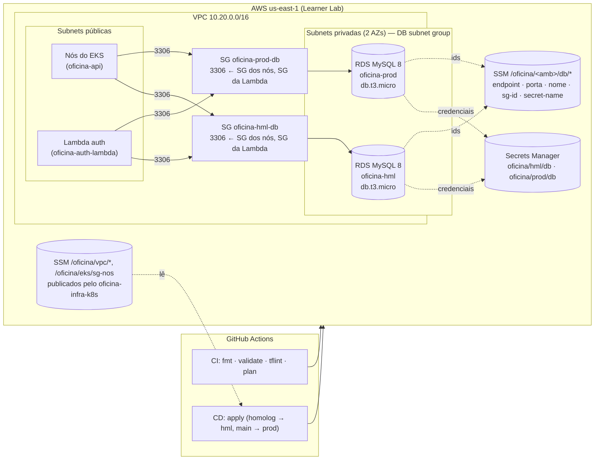

# oficina-infra-db — Banco de Dados Gerenciado (Terraform)

Repositório **3 de 4** do Tech Challenge FIAP SOAT (Fase 3). Provisiona, na **AWS Academy
(Learner Lab)**, o banco de dados gerenciado do sistema da oficina mecânica — **Amazon RDS
MySQL 8**, um por ambiente — e concentra a **documentação do modelo de dados**
([`docs/modelo-de-dados.md`](./docs/modelo-de-dados.md): justificativa do banco, diagrama ER,
relacionamentos e ajustes propostos).

| Repositório | Papel |
| --- | --- |
| [oficina-auth-lambda](https://github.com/Fabio-GST/oficina-auth-lambda) | Function Serverless de autenticação por CPF (emite o JWT) |
| [oficina-infra-k8s](https://github.com/Fabio-GST/oficina-infra-k8s) | VPC, EKS, namespaces por ambiente, API Gateway, parâmetros no SSM |
| **oficina-infra-db** (este) | RDS MySQL por ambiente, Secrets Manager, parâmetros no SSM, modelo de dados |
| [oficina-api](https://github.com/Fabio-GST/oficina-api) | Aplicação principal (AdonisJS) executando no EKS — [Swagger/OpenAPI](https://github.com/Fabio-GST/oficina-api/blob/main/docs/openapi.json) |

Não há Dockerfile neste repositório: ele só contém Terraform e documentação. A API e a Lambda
que consomem o banco têm seus próprios artefatos nos repositórios acima.

🎬 **Vídeo de demonstração da Fase 3** (até 15 min): [assistir](https://drive.google.com/file/d/1RDWC32xFUaCeHpzbTpB_Rg1yz7Fi58Ie/view?usp=sharing) — roteiro e capturas no repositório [oficina-api](https://github.com/Fabio-GST/oficina-api/blob/main/docs/roteiro-video-fase-3.md).

## Arquitetura deste repositório



O que é criado por ambiente (`hml`, `prod`):

| Recurso | Para quê |
| --- | --- |
| `aws_db_instance` MySQL 8 (`db.t3.micro`, 20 GB gp3 criptografado, backups automáticos) | O banco gerenciado da aplicação |
| `aws_security_group` + regra 3306 vinda do SG dos nós do EKS | Só a API (e a Lambda, que adiciona sua regra) alcançam o banco |
| `aws_secretsmanager_secret` `oficina/<amb>/db` | Host, porta, schema, usuário e senha (gerada por `random_password`) em JSON, com chaves `DB_*` prontas para a API |
| `aws_ssm_parameter` `/oficina/<amb>/db/*` | Contrato com os outros repositórios (nada sensível) |

Compartilhados: `aws_db_subnet_group` (subnets privadas) e `aws_db_parameter_group`
(`utf8mb4`, collation `utf8mb4_0900_ai_ci`, fuso UTC).

## Tecnologias

- **Terraform** ≥ 1.5 — providers `aws` 5.x e `random` 3.x
- **Amazon RDS for MySQL 8.0**, **AWS Secrets Manager**, **SSM Parameter Store**
- **GitHub Actions** (CI com `fmt`/`validate`/`tflint`/`plan` comentado no PR; CD com `apply`)
- Estado remoto em **S3 + DynamoDB** (mesmo bucket dos outros repos, key própria)

## Adaptações ao AWS Academy Learner Lab

| Limitação do lab | O que foi feito |
| --- | --- |
| Não cria roles IAM | Enhanced Monitoring e Performance Insights desligados (`monitoring_interval = 0`), pois exigem role. Métricas básicas do CloudWatch continuam disponíveis. |
| Credenciais temporárias, expiram a cada sessão | Pipelines usam `AWS_ACCESS_KEY_ID` / `AWS_SECRET_ACCESS_KEY` / `AWS_SESSION_TOKEN` como secrets, renovados pelo script [`atualizar-credenciais-aws.sh`](https://github.com/Fabio-GST/oficina-infra-k8s/blob/main/scripts/atualizar-credenciais-aws.sh) do repo `oficina-infra-k8s`. |
| Crédito limitado | `db.t3.micro` single-AZ, `deletion_protection = false`, `skip_final_snapshot = true`, segredo com `recovery_window_in_days = 0` para recriar após `destroy`. Variável `ambientes = ["hml"]` sobe só um banco em sessões de teste. |
| Região | `us-east-1` fixa. |

Custo aproximado: 2 × `db.t3.micro` ≈ **US$ 0,034/h** + storage (~US$ 0,16/GB-mês). Um
`db.t3.micro` cabe no free tier de 12 meses da conta.

## Pré-requisitos

1. **Repo `oficina-infra-k8s` aplicado**: este repositório lê do SSM `/oficina/vpc/id`,
   `/oficina/vpc/cidr`, `/oficina/vpc/subnets-privadas` e `/oficina/eks/sg-nos`. O CD falha
   cedo, com mensagem clara, se eles não existirem.
2. **Backend de estado**: bucket S3 e tabela DynamoDB criados uma vez no lab (os mesmos do repo
   `oficina-infra-k8s`). No GitHub, variáveis do repositório `TF_STATE_BUCKET` e
   `TF_LOCK_TABLE`; opcionalmente `AMBIENTES` (JSON, ex.: `["hml"]`).
3. **Sessão do lab ativa** e secrets `AWS_*` renovados.

## Execução local

```bash
cd terraform
cp backend.hcl.example backend.hcl        # ajuste o bucket
cp terraform.tfvars.example terraform.tfvars

terraform init -backend-config=backend.hcl
terraform plan
terraform apply
```

Para obter as credenciais de um ambiente (saída `comando_credenciais`):

```bash
aws secretsmanager get-secret-value --secret-id oficina/hml/db --query SecretString --output text | jq
```

Para conectar a partir da sua máquina é preciso estar dentro da VPC (por exemplo, um
`kubectl run -it --rm mysql --image=mysql:8 -- mysql -h <endpoint> -u oficina_admin -p` no
cluster). O banco não tem IP público por decisão de segurança.

Ao fim da sessão do lab:

```bash
terraform destroy
```

ou, pelo GitHub, **Actions → CD → Run workflow → destruir = true**.

## Deploy (CI/CD)

| Evento | Workflow | O que faz |
| --- | --- | --- |
| Pull request para `homolog` ou `main` | [`ci.yml`](./.github/workflows/ci.yml) | `terraform fmt -check`, `validate`, `tflint`; `terraform plan` comentado no PR (pulado se os secrets do lab não existirem) |
| Push em `homolog` | [`cd.yml`](./.github/workflows/cd.yml), environment **hml** | Verifica a rede no SSM, `terraform apply`, smoke test (instâncias `available`, segredos existem), resumo com os outputs |
| Push em `main` | `cd.yml`, environment **prod** | Idem, sob as regras de aprovação do environment `prod` |
| Manual (`workflow_dispatch`) | `cd.yml` com `destruir = true` | `terraform destroy` ao encerrar a sessão |

`main` e `homolog` são protegidas: sem commits diretos, merge só por pull request com o CI
verde. Os bancos dos dois ambientes ficam em um único state; a branch define o environment
do GitHub (aprovações), não o conjunto de recursos.

## Contrato com os outros repositórios

Publicado no SSM Parameter Store por ambiente (`hml`, `prod`):

| Parâmetro | Conteúdo | Quem lê |
| --- | --- | --- |
| `/oficina/<amb>/db/endpoint` | host do RDS | `oficina-auth-lambda` |
| `/oficina/<amb>/db/porta` | `3306` | `oficina-auth-lambda` |
| `/oficina/<amb>/db/nome` | schema (`oficina`) | `oficina-auth-lambda` |
| `/oficina/<amb>/db/sg-id` | SG do banco — a Lambda adiciona uma regra de entrada 3306 para o próprio SG | `oficina-auth-lambda` |
| `/oficina/<amb>/db/secret-name` / `secret-arn` | segredo com as credenciais | `oficina-api` (CD monta o Secret do Kubernetes), `oficina-auth-lambda` |

Formato do segredo `oficina/<amb>/db`:

```json
{
  "engine": "mysql", "host": "...", "port": 3306, "dbname": "oficina",
  "username": "oficina_admin", "password": "...",
  "DB_HOST": "...", "DB_PORT": "3306", "DB_DATABASE": "oficina",
  "DB_USER": "oficina_admin", "DB_PASSWORD": "..."
}
```

## Modelo de dados

Diagrama ER, relacionamentos, justificativa formal do MySQL/RDS e ajustes propostos (coluna
`ativo` em `clientes` para a autenticação por CPF, FK de `pagamentos`, índices para a listagem
por status e para os dashboards): [`docs/modelo-de-dados.md`](./docs/modelo-de-dados.md).

## Swagger / Postman

Este repositório não expõe APIs. A documentação OpenAPI da aplicação que usa este banco está
em [`oficina-api/docs/openapi.json`](https://github.com/Fabio-GST/oficina-api/blob/main/docs/openapi.json)
(servida em `/docs` pela API).
