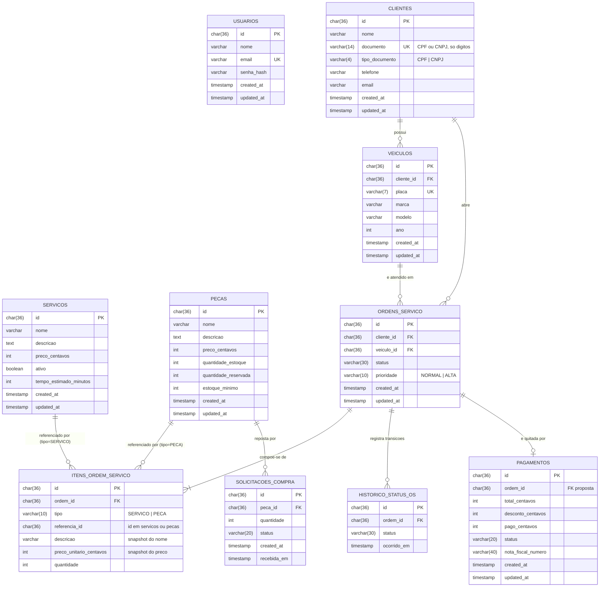

# Modelo de dados da oficina mecânica

Documento de referência do banco relacional do sistema (Tech Challenge FIAP SOAT, Fase 3).
Cobre a **justificativa formal** do banco escolhido, o **diagrama ER** do modelo atual, a
explicação dos relacionamentos e os **ajustes propostos** para consistência e performance.

> As migrações que materializam este modelo vivem no repositório da aplicação
> ([`oficina-api/database/migrations`](https://github.com/Fabio-GST/oficina-api/tree/main/database/migrations)),
> pois o schema evolui junto com o código. Este repositório provisiona o serviço gerenciado
> (RDS) e é a fonte única da documentação do modelo — ver ADR
> [0006 – Migrações pertencem à aplicação](https://github.com/Fabio-GST/oficina-api/blob/main/docs/adr).

## 1. Por que um banco relacional, por que MySQL, por que RDS

### Natureza do domínio

O núcleo do negócio é a **ordem de serviço (OS)** e tudo gira em torno dela: um cliente possui
veículos; uma OS pertence a um cliente e a um veículo; a OS agrega itens que referenciam
serviços e peças; peças têm estoque reservado e consumido pela OS; pagamentos quitam uma OS.
São entidades com identidade estável, relacionamentos fixos e regras de integridade fortes.

Dois requisitos funcionais da Fase 2 definem a escolha:

| Requisito | Implicação no banco |
| --- | --- |
| Baixa de estoque e gravação da OS devem ser **atômicas** (Unidade de Trabalho) | Transações ACID com várias tabelas na mesma operação |
| Listagem ordenada por **status** e **antiguidade**, excluindo finalizadas/entregues | Consulta com filtro + ordenação sobre colunas indexáveis, barata em SQL |

Um banco **relacional** entrega isso nativamente: chaves estrangeiras garantem que não exista
OS sem cliente nem item sem OS; transações garantem que estoque e OS nunca fiquem
inconsistentes entre si; `JOIN`s resolvem relatórios (volume por dia, tempo por status) sem
duplicar dados. Um banco de documentos exigiria desnormalizar o estoque dentro da OS ou
implementar compensações manuais, trocando simplicidade por risco.

### Por que MySQL 8

- **Continuidade**: a aplicação já usa MySQL desde a Fase 1 via Lucid (ORM do AdonisJS), com
  11 migrações e seeds prontos. Trocar o engine agora não traria ganho funcional.
- **Transações e integridade** com InnoDB (ACID, FKs, `ON DELETE` declarativo).
- **Operação conhecida** pela equipe e pelo ecossistema Node (`mysql2`), reaproveitado
  também pela Function Serverless de autenticação.
- `utf8mb4` + collation `utf8mb4_0900_ai_ci` cobrem acentuação do português com busca
  insensível a acento e caixa (nomes de clientes, modelos de veículo).
- PostgreSQL seria igualmente adequado tecnicamente; a decisão foi registrada na
  [RFC 0002 – Banco gerenciado](https://github.com/Fabio-GST/oficina-api/blob/main/docs/rfc)
  com os critérios acima e o custo de migração como fator decisivo.

### Por que gerenciado (Amazon RDS)

Na Fase 2 o MySQL rodava em um `StatefulSet` dentro do cluster: sem backup automático, sem
patching, com volume preso a um nó. O RDS entrega **backups automáticos**, janelas de
manutenção, criptografia em repouso, métricas no CloudWatch e isolamento de rede (subnets
privadas, security group) sem código operacional nosso.

Escolhas desta fase e o que mudaria em produção real:

| Aqui (AWS Academy) | Produção |
| --- | --- |
| `db.t3.micro`, 20 GB gp3, single-AZ | Multi-AZ, classe dimensionada por carga |
| `deletion_protection = false`, sem snapshot final | Proteção ligada, snapshot final e retenção ≥ 7 dias |
| Sem Enhanced Monitoring / Performance Insights (exigem role IAM) | Ligados, com alarmes de CPU, conexões e IOPS |
| Senha mestre no Secrets Manager, rotação manual | Rotação automática por Lambda do Secrets Manager |

## 2. Diagrama ER (modelo atual)

Convenções: chaves primárias são **UUID v4** em `char(36)` geradas pela aplicação (permite
criar agregados inteiros antes de tocar o banco e evita expor contadores). Valores monetários
são **inteiros em centavos** (sem erro de ponto flutuante). Datas em UTC (`time_zone` do
parameter group).

## 3. Relacionamentos

| Relacionamento | Cardinalidade | Regra de integridade | Por quê |
| --- | --- | --- | --- |
| `clientes` → `veiculos` | 1:N | FK `cliente_id`, `ON DELETE CASCADE` | Veículo não existe sem dono; remover o cliente remove seus veículos. |
| `clientes` → `ordens_servico` | 1:N | FK `cliente_id`, `ON DELETE RESTRICT` | OS é registro fiscal/histórico: cliente com OS não pode ser apagado (usar inativação, ver §4). |
| `veiculos` → `ordens_servico` | 1:N | FK `veiculo_id`, `ON DELETE RESTRICT` | Mesmo motivo. Em conjunto com a regra acima, o `CASCADE` de cliente→veículo só ocorre quando não há OS. |
| `ordens_servico` → `itens_ordem_servico` | 1:N (mín. 1 na prática) | FK `ordem_id`, `ON DELETE CASCADE` | Itens são parte do agregado OS; não têm vida própria. |
| `ordens_servico` → `historico_status_os` | 1:N | FK `ordem_id`, `ON DELETE CASCADE` | Cada transição de status gera uma linha com `ocorrido_em`; é a base do indicador **tempo médio por status** do dashboard. |
| `servicos` / `pecas` → `itens_ordem_servico` | 1:N (polimórfico) | `tipo` + `referencia_id`, **sem FK física** | O item guarda **snapshot** de descrição e preço: alterar o catálogo depois não muda OS antigas. A ausência de FK é deliberada e compensada pela validação no caso de uso. |
| `pecas` → `solicitacoes_compra` | 1:N | FK `peca_id` | Reposição de estoque quando `quantidade_estoque - quantidade_reservada < estoque_minimo`. |
| `ordens_servico` → `pagamentos` | 1:0..1 | `ordem_id` **sem FK hoje** | Cada OS tem no máximo um pagamento. FK e unicidade propostas em §4. |
| `usuarios` | isolada | — | Usuários administrativos (atendente/mecânico) autenticados por e-mail/senha; não se relacionam com clientes. A autenticação do **cliente** por CPF (Lambda) consulta `clientes.documento`. |

Fluxo de estoque: ao incluir uma peça na OS, `quantidade_reservada` sobe; ao executar o
serviço, `quantidade_estoque` e `quantidade_reservada` caem juntas; ao cancelar, só a reserva
cai. Tudo na mesma transação da OS.

## 4. Ajustes propostos ao modelo relacional

Levantados ao preparar o banco gerenciado e a autenticação por CPF. Cada item vira uma
migração no repositório `oficina-api`; a ordem segue a prioridade.

### 4.1 Consistência

| # | Ajuste | Motivo |
| --- | --- | --- |
| 1 | `clientes.ativo BOOLEAN NOT NULL DEFAULT TRUE` | Requisito da Fase 3: a Function Serverless deve consultar **existência e status** do cliente antes de emitir o JWT. Também é a alternativa correta ao `DELETE` bloqueado pelo `RESTRICT` das OS (inativação lógica). |
| 2 | `pagamentos.ordem_id` → FK para `ordens_servico(id)` `ON DELETE RESTRICT` + `UNIQUE` | Hoje aceita OS inexistente e dois pagamentos para a mesma OS. |
| 3 | `solicitacoes_compra.peca_id` com `ON DELETE RESTRICT` explícito | Evita apagar peça com reposição pendente. |
| 4 | `CHECK (quantidade_reservada <= quantidade_estoque)` em `pecas` e `CHECK (quantidade > 0)` em `itens_ordem_servico` | MySQL 8.0.16+ aplica `CHECK`; protege o invariante do estoque mesmo fora do caso de uso. |
| 5 | `ordens_servico.status` e `prioridade` como `ENUM` ou tabela de domínio | Impede valores fora do ciclo de vida (Recebida → Em Diagnóstico → Aguardando Aprovação → Em Execução → Finalizada → Entregue). Mantido como `varchar` por ora para não acoplar o banco ao enum do domínio; registrar como dívida técnica. |

### 4.2 Performance

| # | Índice | Consulta beneficiada |
| --- | --- | --- |
| 6 | `ordens_servico (status, created_at)` | Listagem ordenada por status e antiguidade, com `WHERE status NOT IN ('FINALIZADA','ENTREGUE')`. Hoje faz full scan. |
| 7 | `ordens_servico (cliente_id, created_at)` | Rotas do **cliente autenticado por CPF** ("minhas OS"), nova nesta fase. |
| 8 | `historico_status_os (ordem_id, ocorrido_em)` | Cálculo do tempo entre transições (dashboard de tempo médio por status). |
| 9 | `historico_status_os (ocorrido_em)` | Volume diário de OS criadas (`status='RECEBIDA'` por dia) para o dashboard. |
| 10 | `itens_ordem_servico (ordem_id)` | Carregar o agregado; FK em MySQL já cria índice, listado para explicitar. |
| 11 | `pagamentos (ordem_id)` | Vem junto com a FK do item 2. |

Já existentes e corretos: `clientes.documento UNIQUE` (login por CPF é um `SELECT` por
chave única), `veiculos.placa UNIQUE`, `usuarios.email UNIQUE`.

### 4.3 Operação

- **Charset**: `utf8mb4` / `utf8mb4_0900_ai_ci` fixados no parameter group deste repositório.
- **Fuso**: UTC no servidor; a aplicação converte para exibição.
- **Backups**: 1 dia em `hml`, 7 em `prod` (automáticos do RDS). Em produção real, PITR e
  snapshot antes de cada migração destrutiva.
- **Acesso**: só os nós do EKS e a Lambda alcançam a porta 3306 (security groups); nenhum IP
  público. Credenciais no Secrets Manager, nunca em variável de pipeline.

## 5. Como o modelo é consumido

| Consumidor | Acesso | Tabelas |
| --- | --- | --- |
| `oficina-api` (EKS) | Lucid, usuário mestre via Secret do Kubernetes montado pelo CD | todas |
| `oficina-auth-lambda` | `mysql2`, credenciais lidas do Secrets Manager em runtime | `clientes` (leitura: `id, nome, documento, ativo`) |
| Migrações | Job Kubernetes `migration-job` do `oficina-api`, antes de cada rollout | DDL |

Recomendação para evolução: criar um usuário MySQL de **leitura restrita a `clientes`** para a
Lambda (princípio do menor privilégio). Não feito agora porque o Terraform não alcança o
banco em subnets privadas para executar o `CREATE USER`; a alternativa é o próprio job de
migração da aplicação criá-lo.
